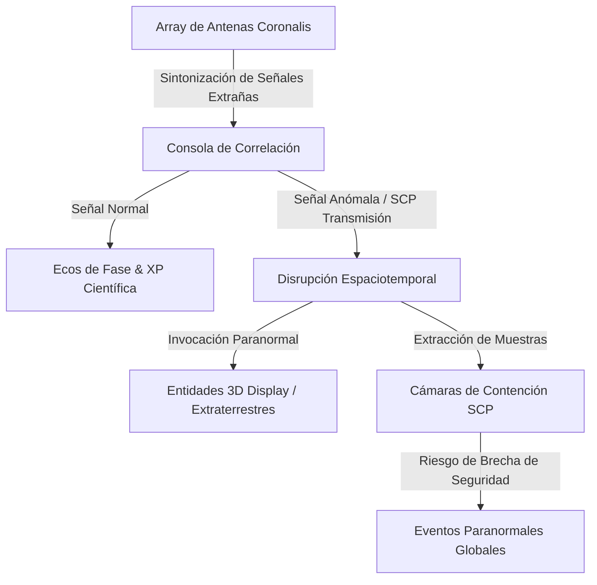

# 🛸 Coronalis: Arquitectura de Evolución — Del Observatorio de Radioastronomía a la Fundación SCP

> **Autor & Creador:** Jack (JackStar6677-1) — Star Systems & DrakesCraft Labs  
> **Ecosistema:** StarSuites / DrakesCraft Season Two  
> **Inspiración Técnica & Estética:** Pylon (Renderizado y bloques dinámicos), MultiverseCreatures (DisplaySuit de Chagui68), SCP Foundation Lore & Signals from Beyond.

---

## 🌌 1. La Visión: ¿Por qué Coronalis no murió?

Coronalis nació como un observatorio de radioastronomía interferométrica (`Escucha del Vacío`), pero su potencial en Slimefun se vio subestimado al limitarse a generar XP y ecodatos estáticos.

**La Gran Evolución:**  
Al escuchar el espacio profundo (M87*, Púlsar PSR B1919+21, Kepler-186f), el radiotelescopio no solo recibe ondas electromagnéticas... **empieza a captar transmisiones anómalas, entidades no euclidianas y balizas alienígenas**.  
Coronalis evoluciona formalmente a un **ecosistema de Radioastronomía Profunda, Eventos Paranormales y Contención SCP** para Minecraft.

---

## 🏛️ 2. Los Cuatro Pilares de la Expansión

### Pilar I: Modelos 3D Procedurales con BlockDisplay & ItemDisplay (Técnica DisplaySuit & Pylon)
- **Cero Dependencia de OptiFine o CustomModelData rígidos:**
  - Siguiendo el patrón `DisplaySuit` de Chagui68 (`MultiverseCreatures`) y el pipeline de renderizado de `Pylon-Drake`:
  - **Parábolas Móviles:** Las antenas ya no son cabezas estáticas; cuentan con un plato parabólico 3D compuesto por `BlockDisplay` e `ItemDisplay` que rota sobre su eje de Azimut y Elevación buscando el cuadrante celeste seleccionado en tiempo real.
  - **Consola Holográfica:** La Consola de Correlación proyecta sobre su chasis un mapa holográfico del cielo profundo y gráficos de onda de señal.
  - **Limpieza de Huérfanos:** Persistencia en PDC de UUIDs y limpieza en `chunkUnload` y `onDisable` para evitar entidades fantasma.

### Pilar II: El Catálogo Paranormal & Señales SCP
Además de los cuerpos celestes astronómicos, se añaden frecuencias clasificadas:
1. **SCP-2399 (El Destructor Averiado):** Señal electromagnética proveniente de Júpiter. Al triangularla, genera interferencia masiva en las brújulas y relojes de los jugadores.
2. **Señal WOW! — Frecuencia 1420.456 MHz:** Transmisión con código binario decodificable en la consola; recompensa con planos de ingeniería cuántica.
3. **El Susurro del Vacío (Anomalía Keter):** Sonidos ultrasónicos reproducidos con audio posicional 3D (`SoundManager`) que inducen náuseas y alucinaciones visuales si el jugador no utiliza protección auditiva.
4. **La Flota Errante (Extraterrestres Tipo III):** Evento donde naves de reconocimiento atraviesan la atmósfera superior de noche, dejando rastros de partículas de plasma y metales cósmicos.

### Pilar III: Maquinaria de Laboratorio y Contención
- **Cámara de Aislamiento Faraday:** Sala multibloque para resguardar las computadoras y evitar que las llamaradas solares o pulsos electromagnéticos frían la red logística.
- **Incubadora de Ectoplasma / Materia Extraña:** Máquina cuántica que condensa las ondas captadas en elementos tangibles: *Polvo Estelar Concentrado*, *Aleación de Púlsar* y *Célula de Energía del Vacío*.
- **Transmisor Cuántico de Balizas:** Permite emitir respuestas al espacio. ¡Cuidado! Responder puede atraer naves nodriza o criaturas hostiles hacia las coordenadas del observatorio.

### Pilar IV: Invasiones Paranormales & Brechas de Contención
- Eventos dinámicos en el servidor orquestados por `CosmicEventManager`:
  - **Noche de Eclipse Psíquico:** Los mobs hostiles cercanos a un array activo mutan con texturas sombrías y mayor resistencia.
  - **Aparición de Visitantes (Aliens Grises / Espectros del Vacío):** Entidades creadas mediante displays y partículas que investigan las construcciones de los jugadores, abren cofres o teletransportan objetos.
  - **Protocolo de Cuarentena:** Alarma audible en todo el distrito del observatorio con luces estroboscópicas rojas cuando una entidad extraterrestre aterriza.

---

## 🛠️ 3. Hoja de Ruta de Implementación (Roadmap)

| Fase | Título | Entregables |
|---|---|---|
| **Fase 1** | *Renovación & Preservación* | Modernizar `pom.xml` a Java 21/25, compatibilidad directa con `Drakes-Suites` (`drakes-magic.jar`), pulido del README oficial. |
| **Fase 2** | *Modelado 3D Display* | Implementación de `AntennaDisplayModel.java` con rotación suave (`InterpolationDuration`) de parábola según Azimut/Elevación. |
| **Fase 3** | *Transmisiones Anómalas* | Añadir 5 señales SCP al `CelestialTarget`, decodificador criptográfico en la GUI de la consola. |
| **Fase 4** | *Entidades Extraterrestres* | Spawner de drones alienígenas y sombras del vacío con comportamientos autónomos (IA básica Bukkit/Display). |
| **Fase 5** | *Integración SAORI & Web* | Telemetría enviada a SAORI de eventos paranormales; alertas en el canal `#⛏️・ᴀɴᴜɴᴄɪᴏs-ᴍɪɴᴇᴄʀᴀғᴛ` de Discord. |
